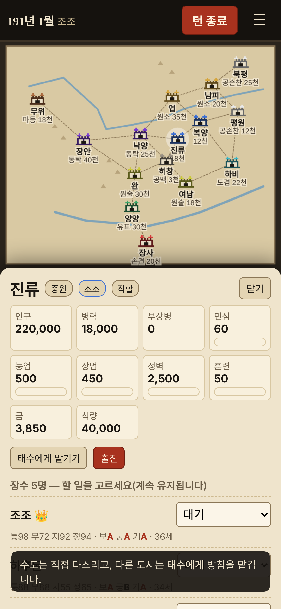
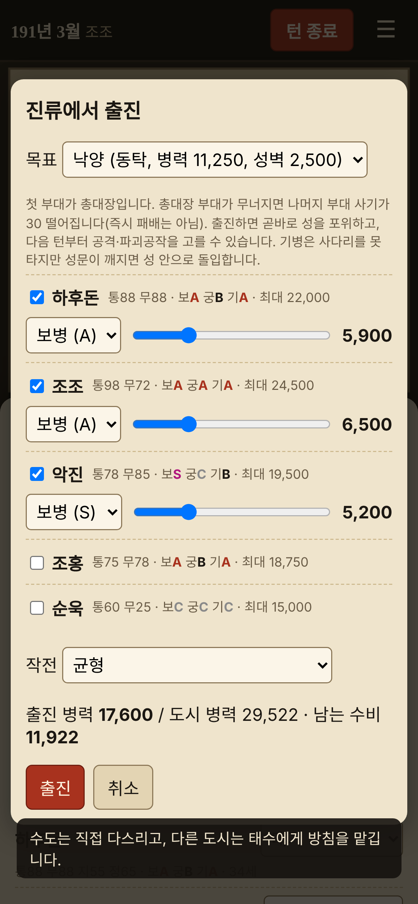
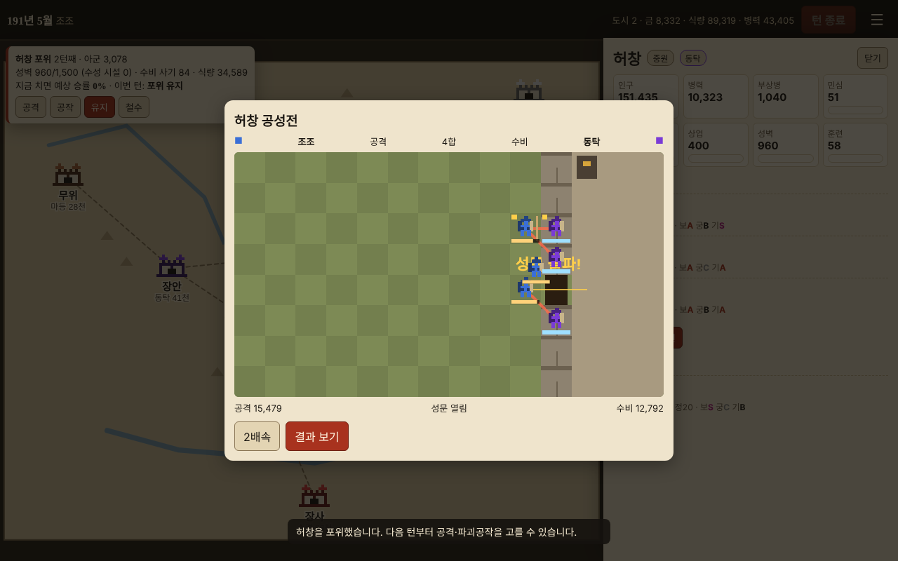

# 삼국쟁투 (Battle of Three Kingdoms) v0.1.1

후한 말 191년, 중원 15개 도시를 두고 아홉 군웅이 다투는 **턴제 전략 웹게임**입니다. 1턴은 한 달이며, 휴대폰과 PC 브라우저에서 혼자 AI 세력들과 겨룹니다. 서버가 없어서 저장은 각자의 브라우저에 남습니다.

| 휴대폰 지도 | 출진 | 공성전 관전(PC) |
|---|---|---|
|  |  |  |

## 하는 법
1. `dist/index.html`을 브라우저로 엽니다(파일 하나라 더블클릭으로 열립니다). 웹 서버에 이 파일 하나만 올려도 그대로 서비스됩니다.
2. **새 게임**에서 군웅을 고릅니다. 「가상 인재」를 끄면 역사 인물만 나옵니다.
3. 지도에서 도시를 누르면 정보창이 열립니다.
   - **수도(직할)**: 장수마다 할 일을 고릅니다(농업·상업·성벽·징병·훈련·인재 탐색·등용·파괴공작·이동). 한 번 고르면 바꿀 때까지 계속합니다.
   - **다른 도시(위임)**: 태수에게 방침만 줍니다(알아서·개발·징병·방어·공략+목표). 「직접 다스리기」로 언제든 바꿀 수 있습니다. 적 세력도 똑같은 규칙으로 움직입니다.
4. **출진**: 장수 최대 4명, 병종(보병·궁병·기병)과 병력을 정하면 곧바로 성을 포위합니다. 첫 부대가 총대장입니다.
5. **포위 카드**(지도 왼쪽 위): 매 턴 「공격 / 공작 / 유지 / 철수」를 고릅니다. 「지금 치면 예상 승률」이 같이 나옵니다.
6. **턴 종료**를 누르면 한 달이 흐르고, 내 세력이 낀 전투는 관전 화면으로 보여 줍니다.

## 규칙 핵심
| 풀고 싶은 문제 | 이 게임에서는 |
|---|---|
| 한 병종만 쓰면 이기는 전투 | 기병→궁병 1.4배, 보병→기병 1.15배. 궁병은 앞줄 없이는 무너짐. 혼성군 피해 비중 보병 36% · 궁병 37% · 기병 27% |
| 수비가 너무 강하고 공성 방법이 하나뿐 | 포위할수록 수비 사기가 떨어지고, 파괴공작으로 성벽(=수성 시설 수)을 깎음. 성문이 깨지면 기병이 성 안으로 돌입 |
| 총대장이 쓰러지면 즉시 패배 | 총대장 부대가 무너지면 남은 부대 사기 −30. 전투는 한쪽이 다 무너질 때 끝 |
| 병력 회복이 너무 느림 | 인구 비례로 넉넉히 뽑되 인구·민심(−3)이 줄어듦. 잃은 병력의 일부는 부상병으로 돌아옴(이긴 쪽 40%, 진 쪽 20%, 매 턴 25%씩 복귀) |
| 장수가 다 죽으면 끝 | 역사 2세가 정해진 해에 등장(조비 203년, 손권 196년, 마초 192년 등) + 장수가 모자란 지역에 가상 인재가 재야로 나타남(서량은 기병, 형주는 궁병 적성이 높음) |
| 기능을 유료로 잠금 | 모든 기능이 처음부터 열려 있음 |

## 개발자용
| 명령 | 하는 일 |
|---|---|
| `python3 build.py` | `src/`를 `dist/index.html` 한 장으로 합침 |
| `node --test tests/unit/*.test.js` | 규칙 단위 시험(21개) |
| `node tests/sim/balance.js 200 12` | 병종 상성·혼성군 피해 비중·공성 준비 효과·AI끼리 120턴 12판 |
| `python3 tests/flow.py` | Playwright로 PC(1280×800)·휴대폰(390×844)에서 새 게임→출진→공성전→이어하기 |
| `node tools/readme_gen.js` | 이 README 아래쪽 데이터 표를 게임 데이터에서 다시 만듦 |

- 주소 끝에 `?seed=3`처럼 붙이면 같은 판을 다시 열 수 있습니다(버그 재현용).
- 구조: `src/data.js`(표) · `src/core.js`(화면과 무관한 규칙, Node에서도 돎) · `src/ui.js`(그리기·입력) · `src/shell.html`, `src/style.css`
- 저장: `localStorage['gunung_save']`(개발 때 이름을 그대로 둠), `saveVer` 1, 옛 판은 `migrate()`가 옮김
- 설계서 `docs/specs/2026-11-10-삼국쟁투-설계.md`, 계획서 `docs/plans/2026-11-10-삼국쟁투-v0.1.md`, 개발 일지 `LOG.md`

## 참고 자료
- 진수 『삼국지』(정사)와 배송지 주: 인물 생몰년, 소속, 191년 무렵 세력 판도
- 나관중 『삼국지연의』: 인물의 활약상과 성격

출생년이 전하지 않는 인물은 추정값입니다. 능력치·병종 적성은 위 두 책의 기록을 근거로 이 프로젝트에서 새로 정했습니다. 그림은 모두 코드로 그린 도트이며 외부 이미지·글꼴 파일을 쓰지 않습니다.

## 라이선스와 공개 서비스
이 저장소는 [MIT 라이선스](LICENSE)(Copyright (c) 2026 Arthur)로 공개합니다.

- 누구나 이 게임을 **무료로 쓰고, 고치고, 다시 배포하고, 공개 웹 서비스로 운영**할 수 있습니다. 상업적 이용도 허용됩니다.
- 조건은 하나입니다: 배포하거나 서비스하는 결과물에 **저작권 표시와 MIT 라이선스 전문(`LICENSE`)을 함께 남겨 주세요.** 공개 웹 서비스라면 페이지 안이나 소스에 포함하면 됩니다.
- 이 소프트웨어는 「있는 그대로」 제공되며, 어떠한 보증도 하지 않습니다(MIT 라이선스 본문 참고).

<!-- 아래는 tools/readme_gen.js 가 자동으로 만든 부분 -->
## 데이터 표 (자동 생성)

### 세력 (191년 1월)
| 세력 | 도시 | 장수 | 병력 |
|---|---|---|---|
| 조조 | 진류, 복양 | 8 | 30,000 |
| 원소 | 업, 남피 | 9 | 55,000 |
| 동탁 | 장안, 낙양 | 9 | 65,000 |
| 공손찬 | 북평, 평원 | 8 | 37,000 |
| 원술 | 완, 여남 | 6 | 48,000 |
| 유표 | 양양 | 8 | 30,000 |
| 손견 | 장사 | 6 | 20,000 |
| 도겸 | 하비 | 5 | 22,000 |
| 마등 | 무위 | 3 | 18,000 |

### 도시
| 도시 | 지역 | 인구 | 성벽 | 수성 시설 | 이웃 |
|---|---|---|---|---|---|
| 무위 | 서량 | 15만 | 2000 | 2 | 장안 |
| 장안 | 관중 | 40만 | 4000 | 4 | 무위, 낙양, 완 |
| 낙양 | 중원 | 12만 | 2500 | 2 | 장안, 업, 진류, 허창, 완 |
| 업 | 하북 | 35만 | 3500 | 3 | 낙양, 남피, 복양 |
| 남피 | 하북 | 20만 | 2500 | 2 | 업, 북평, 평원 |
| 북평 | 하북 | 15만 | 2500 | 2 | 남피 |
| 평원 | 하북 | 15만 | 1800 | 1 | 남피, 복양, 하비 |
| 진류 | 중원 | 22만 | 2500 | 2 | 낙양, 복양, 허창 |
| 복양 | 중원 | 18만 | 2200 | 2 | 업, 평원, 진류, 하비 |
| 허창 | 중원 | 15만 | 1500 | 1 | 낙양, 진류, 완, 여남 |
| 완 | 형주 | 30만 | 3000 | 3 | 장안, 낙양, 허창, 양양 |
| 여남 | 중원 | 25만 | 2200 | 2 | 허창, 하비 |
| 양양 | 형주 | 30만 | 4000 | 4 | 완, 장사 |
| 장사 | 형주 | 18만 | 2200 | 2 | 양양 |
| 하비 | 서주 | 25만 | 3200 | 3 | 평원, 복양, 여남 |

### 병종
| 병종 | 이동 | 사거리 | 공격 | 방어 | 상성(이 병종이 때릴 때) |
|---|---|---|---|---|---|
| 보병 | 2 | 1 | 1 | 1.15 | 보병×1, 궁병×1, 기병×1.15 |
| 궁병 | 2 | 4 | 0.8 | 0.85 | 보병×1, 궁병×1, 기병×1.1 |
| 기병 | 4 | 1 | 1.35 | 0.95 | 보병×1, 궁병×1.4, 기병×1 |

### 장수 (69명, 능력치 = 통솔/무력/지력/정치, 적성 = 보궁기)
| 이름 | 소속 | 생몰 | 능력치 | 적성 | 비고 |
|---|---|---|---|---|---|
| 동탁 | 동탁 | 139–192 | 85/80/60/30 | BBA |  |
| 여포 | 동탁 | 161–198 | 92/100/30/15 | BBS |  |
| 장료 | 동탁 | 169–222 | 90/90/78/55 | ABS |  |
| 화웅 | 동탁 | 150–192 | 75/88/30/20 | ACA |  |
| 서영 | 동탁 | 150–192 | 75/72/55/40 | ABA |  |
| 이각 | 동탁 | 150–198 | 70/72/30/20 | BBA |  |
| 곽사 | 동탁 | 150–197 | 68/70/25/15 | BBA |  |
| 가후 | 동탁 | 147–223 | 75/40/97/80 | BBB |  |
| 이유 | 동탁 | 150–192 | 50/30/88/70 | CCC |  |
| 원소 | 원소 | 154–202 | 85/70/72/75 | AAB |  |
| 안량 | 원소 | 160–200 | 80/92/30/30 | ACA |  |
| 문추 | 원소 | 160–200 | 78/92/25/25 | BCA |  |
| 전풍 | 원소 | 150–200 | 60/30/92/80 | CBC |  |
| 저수 | 원소 | 155–200 | 80/40/90/75 | AAB |  |
| 장합 | 원소 | 167–231 | 88/87/65/50 | ABA |  |
| 고람 | 원소 | 165–204 | 75/76/40/35 | ABB |  |
| 심배 | 원소 | 155–204 | 75/45/78/70 | AAC |  |
| 원담 | 원소 | 173–205 | 65/70/40/40 | BBB |  |
| 공손찬 | 공손찬 | 152–199 | 85/85/40/35 | BCS |  |
| 조운 | 공손찬 | 168–229 | 88/95/75/60 | ABS |  |
| 전예 | 공손찬 | 171–252 | 82/65/80/75 | AAA |  |
| 엄강 | 공손찬 | 160–192 | 65/65/30/30 | BBA |  |
| 유비 | 공손찬 | 161–223 | 80/75/75/80 | ABA |  |
| 관우 | 공손찬 | 160–220 | 95/97/75/60 | SBA |  |
| 장비 | 공손찬 | 165–221 | 85/98/30/25 | SCA |  |
| 전해 | 공손찬 | 165–199 | 70/68/40/35 | BBA |  |
| 조조 | 조조 | 155–220 | 98/72/92/94 | AAA |  |
| 하후돈 | 조조 | 157–220 | 88/88/55/65 | ABA |  |
| 조홍 | 조조 | 169–232 | 75/78/40/45 | ABA |  |
| 악진 | 조조 | 160–218 | 78/85/45/40 | SCB |  |
| 순욱 | 조조 | 163–212 | 60/25/96/98 | CCC |  |
| 하후연 | 조조 | 160–219 | 87/88/50/40 | BAS |  |
| 조인 | 조조 | 168–223 | 90/85/60/50 | SBA |  |
| 전위 | 조조 | 160–197 | 70/97/30/20 | SCB |  |
| 조비 | 조조 | 187–226 | 75/65/75/80 | BBA | 203년 등장 |
| 원술 | 원술 | 155–199 | 70/60/60/55 | BBB |  |
| 기령 | 원술 | 160–199 | 78/80/40/35 | SBB |  |
| 염상 | 원술 | 150–199 | 40/25/75/70 | CCC |  |
| 장훈 | 원술 | 160–199 | 70/68/50/40 | BBB |  |
| 뇌박 | 원술 | 160–209 | 65/70/30/25 | BBB |  |
| 교유 | 원술 | 160–197 | 62/65/30/30 | BBB |  |
| 유표 | 유표 | 142–208 | 72/50/75/82 | AAC |  |
| 괴월 | 유표 | 155–214 | 60/30/90/85 | CBC |  |
| 괴량 | 유표 | 155–210 | 55/25/88/88 | CCC |  |
| 채모 | 유표 | 160–220 | 75/65/65/55 | AAC |  |
| 황조 | 유표 | 150–208 | 72/70/50/40 | BAC |  |
| 문빙 | 유표 | 165–230 | 82/82/60/55 | AAB |  |
| 황충 | 유표 | 147–220 | 85/92/60/50 | BSB |  |
| 유기 | 유표 | 175–209 | 50/40/55/60 | BBC |  |
| 손견 | 손견 | 155–192 | 90/90/70/60 | AAA |  |
| 손책 | 손견 | 175–200 | 92/95/70/70 | ABS |  |
| 황개 | 손견 | 150–215 | 80/82/65/55 | AAB |  |
| 정보 | 손견 | 145–215 | 85/80/70/60 | AAB |  |
| 한당 | 손견 | 155–227 | 78/80/40/40 | ABA |  |
| 주치 | 손견 | 156–224 | 75/70/60/60 | AAB |  |
| 손권 | 손견 | 182–252 | 85/70/80/85 | AAB | 196년 등장 |
| 주유 | 손견 | 175–210 | 95/75/96/85 | ASB | 195년 등장 |
| 도겸 | 도겸 | 132–194 | 60/40/60/70 | BBC |  |
| 조표 | 도겸 | 150–196 | 62/65/30/25 | BBB |  |
| 미축 | 도겸 | 165–221 | 40/30/70/85 | CCC |  |
| 진등 | 도겸 | 163–201 | 75/55/85/80 | BAB |  |
| 장패 | 도겸 | 162–230 | 80/82/50/45 | ABB |  |
| 마등 | 마등 | 156–212 | 82/85/45/40 | BBS |  |
| 한수 | 마등 | 145–215 | 78/72/75/55 | BBA |  |
| 방덕 | 마등 | 170–219 | 80/92/50/40 | ABS |  |
| 마초 | 마등 | 176–222 | 88/97/40/30 | BCS | 192년 등장 |
| 마대 | 마등 | 178–240 | 75/80/45/35 | BBA | 194년 등장 |
| 허저 | 재야 | 170–230 | 80/96/35/20 | SCB |  |
| 서황 | 재야 | 165–227 | 85/90/65/45 | ABA |  |
